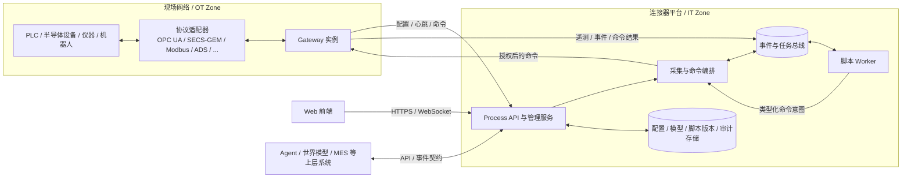
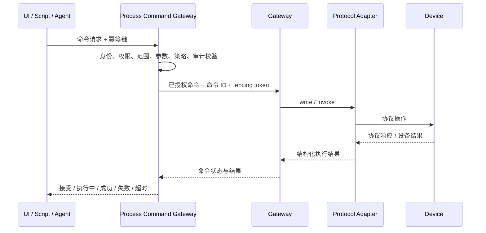

# 工业自动化连接器技术设计

> 状态：架构方案草案 v0.1
> 所属工程：`industrial-automation-connectors`
> 文档边界：定义系统级职责、服务边界、统一能力模型和技术选择。协议驱动内部类设计、配置字段、具体 API 契约和实现细节由 `industrial-automation-connectors` 工程中的后续模块设计维护。

## 1. 背景与目标

工业自动化连接器负责连接 PLC、半导体设备、机器人、仪器和既有自动化系统，为上层提供统一的设备状态、点位数据、事件和可执行操作。系统需要支持长期运行的现场连接、订阅式采集、受控下行，并为工程人员提供界面或脚本来组合订阅数据和操作。

本设计采用三层职责划分：

1. **Gateway（设备网关）**：专注于设备协议会话和现场数据面，保持长连接并运行协议适配器。
2. **Process（业务处理层）**：专注于管理、采集编排、业务逻辑、权限与下行控制。这里的 Process 指平台业务处理服务，不是操作系统进程管理器。
3. **Frontend（前端层）**：提供设备、点位、订阅、脚本和运行状态的配置、调试与监控界面。

核心目标：

- 通过协议适配层接入不同协议，并在协议能力允许的范围内统一为设备、点位、事件和函数调用。
- 长连接与设备会话不依赖管理界面或脚本服务的生命周期。
- 支持周期采集、变化订阅、设备事件、主动读取、写入点位和调用设备函数。
- 允许用户把订阅事件映射为可审查、可测试、可发布、可回滚的处理逻辑。
- 所有真实设备下行都经过后端权限、策略、联锁（如已配置）和审计检查。
- 在 Linux 上部署，并支持后续运行在 Kubernetes；允许边缘 Gateway 与中心 Process 分开部署。
- Agent/模型服务通过正式 API 或事件接口使用连接器能力，不直接持有协议连接或访问连接器内部数据库。

## 2. 范围与非目标

### 2.1 本工程负责

- 现场协议连接、设备会话、数据采集、事件转换和设备操作接口。
- 设备/点位/函数的统一能力描述及其到协议地址、变量和消息的映射。
- Gateway 生命周期、配置下发、连接状态、采集任务执行和命令结果反馈。
- 连接器自身的管理 API、脚本运行边界、审计信息和运维指标。

### 2.2 本工程不负责

- Agent 的模型推理、规划和训练。Agent 可由独立 Python 等服务承载。
- 全局用户身份系统、跨业务域审批和平台级工作流；连接器提供鉴权集成点并强制执行收到的授权上下文。
- 定义工业世界模型。连接器设备模型描述可观测和可操作能力，不代替工艺语义、生产流程或仿真模型。
- 替代 PLC 安全回路、急停、设备联锁和经安全认证的控制系统。软件策略检查不能代替设备本地安全机制。
- 保证任意协议在所有厂商设备上完全兼容。实际能力由具体设备固件、授权、配置和现场联调决定。

## 3. 总体架构



### 3.1 Gateway：设备数据面

Gateway 是靠近设备网络部署的长运行服务，负责：

- 建立、保活、重连和关闭协议会话。
- 根据下发配置创建协议适配器实例、设备会话、点位监视和采集任务。
- 解析协议数据，转换成统一的点位事件、设备事件、连接状态和命令结果。
- 接收授权命令，执行协议写入或函数调用，并返回结构化结果。
- 缓冲短暂网络中断期间可恢复的数据，暴露队列深度、丢弃量和数据时效。

Gateway 不承载用户可编辑的任意业务脚本，不保存平台权威配置，不自行决定某个用户是否有权写入设备。它可以缓存最后一份签名/带版本的有效配置，以便控制面暂时不可达时保持现有会话；缓存配置不可绕过下行授权策略。

“平时不重启”应作为运维目标和生命周期设计原则，而非不可重启的假设。升级、节点故障和 K8s 调度仍可能造成实例重建，因此必须支持会话恢复、任务重新下发、断线状态识别和命令幂等/去重。

### 3.2 Process：管理与业务处理面

Process 提供连接器平台 API 和业务编排，负责：

- Gateway 注册、心跳、版本、健康状态及配置版本管理。
- 站点、Gateway、设备、连接、点位、函数和订阅模型的维护。
- 采集任务创建、更新、暂停、恢复和分配。
- 消费点位/设备事件，触发用户定义的逻辑或转发到其他系统。
- 对下行命令执行身份、角色、设备/点位权限、参数范围、速率限制、联锁条件和审批状态检查。
- 保存命令请求、执行进度、协议结果、超时/取消结果和审计记录。
- 管理脚本版本、校验、测试、发布、停用和回滚。

Process 与 Gateway 之间使用版本化控制契约。Gateway 不需要直连数据库；Process 也不访问 Gateway 内部状态，只通过健康、配置、事件和命令接口交互。

### 3.3 Frontend：配置与运维界面

前端是 Process API 的客户端，应支持：

- Gateway 和设备连接状态、协议版本、最近心跳及错误信息查看。
- 设备树、点位/函数浏览、类型和读写能力查看。
- 单点读取、订阅测试、趋势/事件检查及采集任务配置。
- 脚本编辑、静态校验、样例事件试运行、日志查看、版本差异、发布和回滚。
- 受授权的下行操作入口；危险操作展示目标、参数、风险级别和执行结果。
- 角色和权限控制的 UI 呈现。前端控制只用于交互，后端仍需重新校验。

## 4. 部署拓扑与运行模式

系统支持两种逻辑拓扑，使用相同协议和领域契约：

1. **边缘同站点部署**：Gateway 与 Process 部署在工厂网络或边缘集群内，减少设备访问延迟和广域网依赖。
2. **边缘 Gateway + 中心 Process**：Gateway 在现场网络内，Process/前端在中心集群。Gateway 主动发起受保护的出站连接，避免为中心服务开放到 OT 网络的入站访问。

Kubernetes 部署注意事项：

- Gateway 需要按现场网段、串口设备和协议要求使用节点亲和性、专用节点或设备映射。不要假定 Pod 网络能自动访问串口或现场广播网络。
- 串口类协议需显式映射设备节点并限制容器权限；记录设备节点、波特率、校验位和独占策略。
- 对每个会话分配唯一的活跃 Gateway 所有者。HA 接管需使用租约/租期和 fencing token，防止两个 Gateway 同时写同一设备。
- 对有状态 Gateway 使用优雅退出：停止接收新命令、标记会话迁移/关闭、报告未完成命令，然后终止。
- Liveness 只检查进程是否可工作，不应因单台设备暂时掉线而触发 Gateway 重启；readiness 和设备连接状态分开表达。
- 容器镜像以非 root、只读根文件系统、资源配额和最小网络权限运行。协议所需端口由部署配置明确开放。
- 脚本 Worker 独立于 Gateway，资源隔离并无 OT 网段路由。默认不允许 Worker 访问任意互联网地址。

## 5. 统一设备能力模型

统一模型的目的是让上层使用设备能力，而不必理解协议报文；协议扩展信息仍需保留，以支持诊断和协议特有功能。

### 5.1 核心实体

| 实体 | 关键属性 | 说明 |
| --- | --- | --- |
| Site | `siteId`、名称、时区、网络/安全域 | 现场或逻辑工厂范围。 |
| Gateway | `gatewayId`、站点、版本、状态、能力、配置版本 | 运行协议连接的边缘节点。 |
| Connection | `connectionId`、协议类型、端点、凭据引用、连接状态 | 协议会话或设备连接配置；机密只存储为安全引用。 |
| Device | `deviceId`、名称、厂商、型号、序列号、连接、标签 | 设备逻辑身份；断线后身份仍保持。 |
| Point | `pointId`、路径、数据类型、单位、读/写能力、协议地址、质量 | 变量、状态量、测量值或可写设定值。 |
| Function | `functionId`、输入/输出 schema、风险级别、超时、幂等策略 | 设备可执行方法/命令，不等同于普通点位写入。 |
| Subscription | `subscriptionId`、目标、触发方式、周期/死区、投递策略 | 点位变化、周期读取或设备事件订阅。 |
| Event | 事件 ID、目标、值、来源时间、接收时间、质量、序列号 | 统一遥测、状态、告警或协议事件封装。 |
| Command | 命令 ID、目标、操作、参数、发起者、策略上下文、状态 | 统一下行请求及其执行生命周期。 |

### 5.2 点位值与质量

每个值至少包含：

- `deviceId`、`pointId`、值和声明的数据类型。
- `sourceTimestamp`（设备/协议侧时间，如可获得）与 `ingestTimestamp`（Gateway 接收时间）。
- `quality`：`GOOD`、`UNCERTAIN`、`BAD` 或可扩展的标准枚举；附带协议状态码和诊断详情。
- `sequence` 或版本信息（协议可用时），用于识别重复、乱序和缺口。
- `schemaVersion`、`gatewayId`、`connectionId`，用于追踪来源和映射版本。

值的数据类型应覆盖布尔、整数、有符号/无符号、浮点、字符串、字节数组、枚举、时间戳和结构化类型。精度、端序、缩放、单位和空值行为由点位映射明确定义，不得靠 UI 猜测。

### 5.3 协议地址和能力

点位保留协议适配器的地址映射，例如 OPC UA NodeId、Modbus 区域/偏移/寄存器类型、ADS 符号名、SECS/GEM SVID/CEID/RCMD。地址存放在带 schema 版本的 `protocolConfig` 扩展中，由适配器校验；上层逻辑使用统一 `pointId`。

每个设备和每个点位需声明能力：是否可读、支持的订阅模式、是否可写、函数列表、最大采样速率及协议限制。上层不应假设所有协议支持真正的服务端变化订阅；适配器可把定时轮询包装为统一订阅，并标示实际采样语义。

## 6. 协议适配层

### 6.1 适配器职责与统一操作

协议适配器封装协议栈和厂商差异。系统级适配器能力包括：

- `connect / disconnect / health`：会话生命周期和状态。
- `browse / describe`：在协议支持时发现设备节点、点位或方法。
- `read`：读取一个或多个点位。
- `subscribe / unsubscribe`：订阅值变化或设备事件；不支持时由 Gateway 采集调度器轮询。
- `write`：写入可写点位。
- `invoke`：调用设备函数或协议命令。
- `decode / map`：将原始数据、状态码、告警和异常映射为统一模型。
- `diagnostics`：暴露协议状态、最近报文摘要、错误码和计数器；敏感载荷按策略脱敏。

适配器 SPI 应异步化、可取消，并明确线程安全、超时、重试、背压、最大并发和资源关闭语义。Gateway 统一管理适配器生命周期，适配器不得创建脱离生命周期管理的后台线程。

适配器按协议/厂商分包并版本化。第一阶段采用随 Gateway 镜像发布的静态依赖，避免在线加载任意第三方 JAR。若将来需要独立升级或多语言实现，再定义进程外插件协议；插件不能拥有未授权的任意网络或下行权限。

### 6.2 首批协议候选

下表是候选库和主要风险，不是协议兼容性承诺。必须结合协议标准、具体设备型号、固件、厂商手册、授权要求和现场测试完成选型。

| 协议/设备 | Java/Linux 候选 | 预期用途 | 需要重点验证 |
| --- | --- | --- | --- |
| OPC UA | Eclipse Milo（EPL） | OPC UA Client 连接设备服务器；也可用于服务端能力发布。 | 安全策略与证书生命周期、订阅恢复/队列、方法调用、自定义类型、目标服务器互操作及目标版本支持。 |
| SECS/GEM | `secs4java8`（Apache-2.0）作为评估候选 | HSMS/SECS 消息、SECS-II 编解码及部分 GEM 能力。 | 项目说明为 GEM 部分实现；E30 状态机、变量/事件报告、远程命令、超时和厂商差异需逐项验收。还要处理 SEMI 标准文本的授权和设备端合规范围。 |
| Modbus TCP/RTU | `j2mod`（Apache-2.0）作为评估候选 | 读写线圈/寄存器；RTU 通过串口适配。 | 端序/字序、串口锁、RTU 超时/重试、批量寄存器边界、异常响应、设备地址表；确认实际发布版本和已知 transport 限制。 |
| 倍福（Beckhoff） TwinCAT ADS* | Beckhoff `AdsToJava`（MIT）/ Beckhoff `ADS` Linux 原生库 | TwinCAT 符号读写、通知订阅和 PLC 变量交互。 | AdsToJava 的 Linux 支持当前标记为 beta，包含 JNI/C++ 依赖和已知未支持功能；验证目标发行版、ARM/x86 镜像、AMS Net ID、路由、安全连接、符号变化和 K8s 原生依赖打包。必要时评估设备开放 OPC UA 或 Modbus 接口作为替代。 |

\* 本文将对话中的“贝福 PLC”暂按“倍福（Beckhoff）PLC”理解。若实际指其他厂商，连接器需要基于该厂商的具体型号和通信手册重新评估。

如果目标设备的公开接口是 OPC UA 或 Modbus，优先用标准接口接入；厂商专有协议作为独立适配器实现。Modbus 本身只定义协议，不提供设备寄存器表，寄存器地址和缩放仍需具体型号文档。

### 6.3 开源库准入

引入协议库前需形成简短评估记录：许可证和传递依赖、活跃维护/安全响应、支持的协议子集、目标 Linux 架构、同步/异步行为、断线恢复、性能与内存、诊断能力、测试设备/模拟器及替换成本。不得仅依据 README 的“支持协议”标签就视为生产可用。

## 7. 采集、订阅与事件处理

订阅配置由 Process 保存并分配给 Gateway。每个订阅明确目标、协议模式、周期/死区、队列策略、最大速率、起止时间、持久化和消费策略。

- 若协议提供服务端订阅，适配器尽量使用服务端订阅，并处理 KeepAlive、重建和重订阅。
- 若协议只支持轮询，Gateway 调度器负责合并同设备请求、控制并发和频率，避免每个 UI/脚本订阅产生重复轮询。
- 数据事件写入内部事件总线，带序列号和时间戳。短暂故障允许有限缓存；超过容量时执行明确定义的丢弃/采样策略并产生可观测告警。
- Process 的逻辑订阅使用消费者组或等价机制管理交付；需要严格一次效果时使用幂等处理，不宣称消息传输天然 exactly-once。
- 对数据质量未知、设备断线或 Gateway 切换，发布状态事件，不把旧值静默当作实时 GOOD 值。

内部事件总线和存储实现应通过接口隔离。首个试点可采用单体部署加内嵌队列/轻量消息代理；当需要多 Gateway、多消费者、缓冲和重放时可引入 NATS JetStream 或 Kafka。不得仅为架构图引入尚无用例的基础设施。

## 8. 下行命令与执行控制

统一命令流程：



命令状态至少包括 `RECEIVED`、`VALIDATED`、`DISPATCHED`、`SUCCEEDED`、`FAILED`、`TIMED_OUT`、`CANCELLED` 和 `UNKNOWN`。超时不等于设备未执行；Process 应区分传输超时与设备确认，并为不确定结果提供查询或人工处置路径。

下行规则：

- 写点位与调用函数必须使用显式的能力定义和参数 schema；危险操作可配置额外审批、双人确认或操作窗口。
- 需支持调用方幂等键、平台命令 ID、去重保留时间、目标设备/操作/参数摘要和完整结果审计。
- Gateway 只接受授权上下文完整、配置版本有效且目标归属正确的命令；平台分配会话租约时同时校验 fencing token。
- 只有协议确认语义足够时才报告 `SUCCEEDED`；否则返回 `ACCEPTED` 或 `UNKNOWN` 等准确状态。
- 禁止把脚本或 Agent 生成的设备写入绕过 Process 命令网关直接发往 Gateway。

## 9. 动态逻辑与 Groovy

Groovy 适合作为 Java 平台中的确定性事件逻辑语言，例如过滤、阈值判断、简单计算、状态关联和产生类型化命令意图。它不是设备协议实现语言，也不是 Agent 推理的替代品。

建议链路：

```text
订阅事件 -> 脚本 Worker 执行 Groovy 版本 -> 输出命令意图/结果
         -> Process Command Gateway 检查 -> Gateway 执行协议操作
```

脚本执行约束：

- 每份脚本有 ID、版本、作者、发布状态、输入/输出 schema、权限声明和兼容模型版本。
- Worker 与 Gateway 分进程/容器运行。脚本超时、CPU/内存、并发数和队列长度受限；超限可取消并标记失败。
- 仅通过显式绑定暴露事件、上下文和类型化 API（例如读取点位、产生写入意图、请求函数调用）；不得暴露 Spring 容器、数据库连接、任意文件、反射入口或协议客户端。
- 不将 Groovy AST 限制器视为安全沙箱。Groovy 官方明确说明该限制不是安全边界；真正的隔离依靠独立进程/容器、操作系统权限、网络策略和命令网关。
- 脚本默认不可直连设备网络；输出只能是命令意图，由 Process 重新执行授权和策略检查。
- 提供样例事件测试、历史事件回放（只读/模拟下行）、发布审批、灰度范围、立即停用和回滚。
- 每次运行关联脚本版本、输入事件 ID、输出、耗时、错误和命令 ID；敏感字段按策略脱敏。

如果未来要允许不受信任的多租户用户自行编写任意逻辑，不应直接开放 Groovy；应改用更受限的声明式流程 DSL，或单独评估具有强隔离的运行时。

## 10. API 与集成边界

连接器至少提供以下逻辑 API 能力，具体路径和消息定义留到工程内部 API 设计：

- 设备、点位、函数、Gateway 和连接配置的 CRUD/查询。
- Gateway 注册、心跳、健康、配置拉取/确认和版本报告。
- 采集订阅创建/取消、单点读取、实时事件查询/订阅。
- 点位写入、函数调用、命令状态查询和审计查询。
- 脚本版本管理、校验/试运行、发布/停用/回滚。
- WebSocket 或等价流式接口向 UI 推送状态更新；Agent/其他系统优先使用稳定的 API/事件契约。

HTTP API 适合 UI 管理操作；Gateway 控制通道采用 gRPC 或等价的双向长连接接口；高吞吐/多消费者数据事件使用消息代理。早期可简化部署，但这些领域契约应保持版本化和传输可替换。

事件和命令 schema 采用显式版本。字段兼容规则为向后兼容新增可选字段、禁止复用字段编号/名称表达不同含义，并维护 schema 迁移和消费者兼容策略。

## 11. 技术栈建议

| 部分 | 建议基线 | 选择理由 / 约束 |
| --- | --- | --- |
| Gateway、Process | Java 21 LTS，Spring Boot 3.x；Maven 或 Gradle 二选一，初期建议 Maven | Linux/Kubernetes 生态成熟；协议 SDK 和企业服务集成较多。Java 版本应随目标库兼容矩阵验证。 |
| 协议适配 | Java SPI/接口模块；高风险原生依赖隔离在独立适配器进程 | 保持统一模型，避免 JNI 问题污染 Gateway 主进程。 |
| 动态逻辑 | Groovy 4.x，独立 Worker 进程/容器执行 | 与 Java 互操作方便；需要严格限制可用能力和资源。 |
| 前端 | TypeScript + React 或 Vue；REST 管理 API，WebSocket 实时更新 | 选择团队熟悉的一种，不把协议逻辑放到浏览器。 |
| Agent/模型 | 独立 Python 服务；调用连接器 API 或订阅事件 | 便于使用 AI/数据科学生态；保持与 OT 连接和写入权限隔离。 |
| 配置/元数据 | PostgreSQL | 保存设备模型、连接配置引用、订阅、脚本版本和审计元数据。机密需交给 Secret 管理系统。 |
| 事件传输 | 先根据规模选轻量内嵌队列或 NATS JetStream；需要长期大规模重放时再评估 Kafka | 避免过早强制采用复杂中间件；事件契约独立于选型。 |
| 可观测性 | OpenTelemetry，Prometheus 兼容指标，结构化日志 | 连接、采集、脚本和命令可通过统一 trace/correlation ID 追踪。 |
| 交付 | OCI 容器镜像，Kubernetes manifests/Helm（后续） | 支持边缘与中心部署；协议所需网络和设备访问权限显式声明。 |

Java 是默认主栈。Rust 暂不作为第一阶段实现要求；未来若某个现场 Gateway 受内存、启动时间或原生协议库约束，可把具体适配器做成独立 Rust 服务，通过同一控制/事件/命令契约接入。

## 12. 安全、权限与审计

- 网络分区：OT、Gateway、Process、前端/外部 API 按现场安全策略分区；优先由现场 Gateway 发起出站连接。
- 机密：设备凭证、证书私钥和 ADS 路由密钥存 Secret 管理系统；数据库只保留引用，不在普通日志或脚本上下文出现。
- 认证和授权：Gateway 身份使用证书/工作负载身份；用户和 Agent 命令带可追溯身份、角色和策略上下文。
- 最小权限：每种脚本和调用方只可访问明确设备、点位、函数和命令类型；默认只读。
- 安全写入：参数范围、写入速率、目标白名单、设备状态条件、审批和操作窗口按风险策略配置。不得把软件联锁宣称为安全认证功能。
- 审计：记录谁在何时对哪个设备/点位执行何种操作，脚本/模型/策略版本、命令参数摘要、校验结果、协议响应和最终状态。
- 协议安全：优先配置 OPC UA 安全策略、证书信任和轮换；不为方便默认接受所有证书。未加密协议通过网络隔离、专用 VLAN/VPN 等现场措施限制暴露。
- 日志：可配置是否记录原始报文；默认脱敏，限制保留期和访问权限，避免 SECS/GEM 或设备载荷包含敏感生产数据时泄露。

## 13. 可用性、扩缩容与运维

- Gateway 按站点/设备组/协议能力分片；每个设备会话有明确 owner，重平衡过程考虑断线和命令状态。
- Process API 可无状态扩展；配置和事件消费使用数据库/消息代理中的共享状态协调。
- 断线恢复采用指数退避和抖动，区分设备离线、认证失败、协议不兼容和网络不可达。
- 采集调度有设备级、连接级和 Gateway 级并发/频率上限；拥塞时按配置降采样、暂停低优先级订阅或触发告警。
- Gateway 配置变更支持版本、差异、确认、失败回滚和分批发布；连接参数变更可能导致会话重建，必须展示影响。
- 升级支持 Gateway 分批更新、Process 滚动更新和脚本版本回滚；避免 Gateway 与 Process 的契约版本不兼容。
- 关键指标：在线设备数、连接重试次数、订阅活跃数、采样延迟、事件队列积压、丢弃数、命令成功/失败/超时率、脚本耗时/失败数、配置应用延迟。
- 健康检查分层：服务存活、控制面连接、事件总线可用性、单个 Gateway 状态和单台设备连接状态分别呈现。

## 14. 测试与验收策略

协议适配须在真实设备或经验证的协议模拟器上验证。验收覆盖：

- 正常连接、断线、重连、设备重启、服务重启和配置热更新。
- 数据类型、端序、缩放、时间戳、质量码、空值和异常响应映射。
- 订阅频率、死区、队列溢出、恢复订阅、重复/乱序消息处理。
- 点位写入和函数调用参数校验、权限拒绝、超时、取消、重复请求和未知结果处理。
- 协议安全配置、证书/凭证轮换和失效场景。
- Kubernetes 节点重调度、Gateway 唯一所有者、优雅终止、边缘网络分区和恢复。
- Groovy 沙箱能力边界、超时/内存限制、回放测试、命令策略拒绝和审计关联。
- 对 SECS/GEM，使用真实目标设备验证状态机、设备常见 S/F 消息、厂商扩展及超时；模拟器通过不代表设备互操作验收。

上线前每种协议需有兼容清单，至少记录设备型号/固件、适配器版本、已覆盖功能、限制、现场网络要求和已验证的安全模式。

## 15. 分阶段落地

### 阶段 0：现场和协议确认

选择一个试点站点、设备型号、协议及只读/可写边界。获取协议手册、设备模拟器或测试设备，确认 Linux 网络拓扑、授权和下行风险。

### 阶段 1：最小可运行连接器

实现 Java 服务骨架、设备/连接/点位模型、Gateway 注册与心跳、一个协议适配器、只读采集、状态/质量事件和基础监控。首个协议按试点设备选型，不同时铺开全部协议。

### 阶段 2：订阅和受控下行

加入协议订阅或轮询调度、命令生命周期、后端权限/策略/审计、幂等与超时语义，并通过模拟器和实际设备验证读写行为。

### 阶段 3：前端运维和脚本 Worker

提供设备树、点位浏览、订阅配置、脚本测试和审计界面；Groovy 逻辑在隔离 Worker 中运行，输出命令意图经过统一网关验证。

### 阶段 4：多 Gateway 与 Kubernetes

实现 Gateway owner/租约、配置分发、滚动升级、边缘/中心拓扑、事件缓冲和故障恢复。依据实测负载决定引入消息代理及数据存储系统。

### 阶段 5：扩展协议与 Agent 接口

逐个接入 OPC UA、SECS/GEM、Modbus、倍福 ADS 等经试点确认的协议；稳定事件和命令 API，供 Agent/世界模型通过授权接口使用。

## 16. 待确认的决策

1. 首个试点设备、型号、固件和协议；优先只读还是同时验证写入/方法调用。
2. “贝福 PLC”是否指“倍福（Beckhoff）TwinCAT PLC”。本文暂按此理解。
3. 现场部署是边缘 Kubernetes、普通 Linux 主机，还是二者并存；是否存在串口和多网卡需求。
4. 初期消息传输、遥测历史保留和事件重放的规模要求。
5. 脚本作者是内部可信工程师，还是未来允许外部/多租户用户提交脚本。
6. 下行风险分级、审批规则、自动联锁数据源和人工接管流程。
7. SEMI 规范授权和目标设备 GEM/GEM300 功能范围。

## 17. 参考资料与候选实现

以下链接用于初步技术可行性判断，版本和状态在具体实施时需重新核验：

- [Eclipse Milo：OPC UA 开源 Java 实现](https://github.com/eclipse-milo/milo)；[官方项目说明](https://projects.eclipse.org/projects/iot.milo/governance)
- [secs4java8：Java SECS 通信实现](https://github.com/kenta-shimizu/secs4java8)；仓库声明支持 SECS-I、SECS-II、部分 GEM 和 HSMS，须按目标设备验证。
- [j2mod：Java Modbus 库](https://github.com/steveohara/j2mod)；仓库标明 Apache-2.0 许可证，仍需评估实际 transport 和设备地址映射。
- [Beckhoff AdsToJava](https://github.com/Beckhoff/AdsToJava)；仓库说明 Java ADS 客户端和 Linux 支持状态/限制。
- [Beckhoff ADS/AMS 规范](https://infosys.beckhoff.com/content/1033/tcadscommon/12440276875.html)
- [Beckhoff ADS Linux 开源实现](https://github.com/Beckhoff/ADS)
- [Groovy SecureASTCustomizer 文档](https://docs.groovy-lang.org/latest/html/api/org/codehaus/groovy/control/customizers/SecureASTCustomizer.html)；文档明确它不是安全沙箱或安全边界。
- [Groovy 威胁模型](https://apache.googlesource.com/groovy/%2Bshow/64e0dd1393f25b74fe6f2960e1257b3558477579/THREAT_MODEL.md)
- [Eclipse Kura 文档](https://eclipse-kura.github.io/kura/docs-develop/)；可作为 Java/Linux 边缘连接、资产和 UI/数据流能力的参考，不代表本系统直接采用 Kura。
