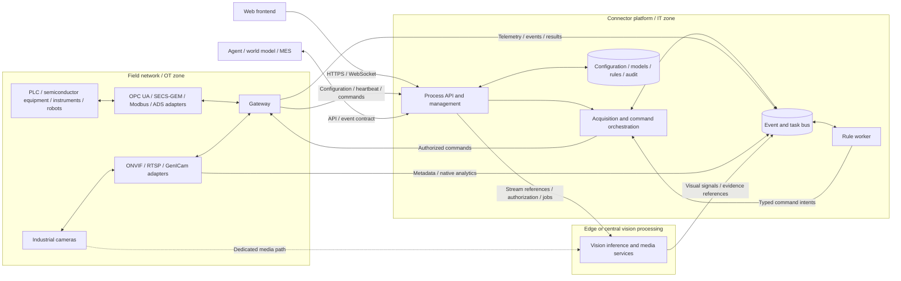
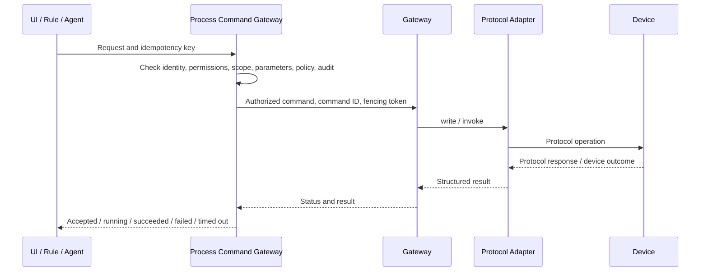

# Industrial Automation Connectors: Technical Design

**English** | [简体中文](technical-design.zh-CN.md)

Architecture draft v0.3 for industrial-automation-connectors. This document defines system responsibilities, service boundaries, the shared capability model, and technology options. Subsequent module designs specify driver internals, configuration fields, API contracts, and implementation details.

## 1. Goals

Connect PLCs, semiconductor equipment, robots, instruments, factory cameras, and existing automation systems. Expose equipment capabilities, points, events, visual signals, and operations. Support long-running sessions, subscriptions, controlled commands, and engineering tools for composing bounded rules.

1. **Gateway** owns device protocol sessions and field data transport. It maintains connections and runs adapters.
2. **Process** is the application service for management, acquisition orchestration, business logic, permissions, and commands.
3. **Frontend** provides configuration, debugging, and monitoring for equipment, points, subscriptions, rules, and runtime health.

Normalize capabilities to the extent each protocol allows. Keep sessions independent of the UI and rule runtime. Support periodic sampling, change subscriptions, events, reads, writes, and function calls. Separate high-bandwidth video from structured analytics. Make rules reviewable, testable, releasable, and reversible. Subject field commands to backend identity, policy, configured interlocks, and audit. Deploy on Linux and later Kubernetes, with edge Gateway and central Process where needed. Agents and model services use formal APIs or events. Protocol connections and internal databases stay private.

## 2. Scope

### 2.1 Connector responsibilities

- Field connections, sessions, acquisition, event conversion, and equipment operation interfaces.
- Camera and machine vision source management, stream metadata, and association of visual events with equipment and production objects.
- Secure delivery of video to separate media or inference services.
- Equipment, point, and function descriptions and mappings to protocol addresses, variables, and messages.
- Gateway lifecycle, configuration delivery, connection status, acquisition jobs, and command results.
- Connector management APIs, bounded rule execution, audit, and operational metrics.

### 2.2 External responsibilities and limits

Agent inference, planning, and training can run in a separate Python service. Global identity, cross-domain approval, and platform workflows have separate owners. Connectors integrate authentication and enforce the authorization context they receive. The industrial world model defines process semantics and simulation behavior. External vision services perform recognition, tracking, and defect detection. PLC safety circuits, emergency stops, interlocks, and certified controls retain their local safety roles. Check protocol compatibility against device firmware, licensing, configuration, and site integration.

## 3. Architecture

Keep video off the point event bus. Manage source identity, access, stream addresses or sessions, and metadata in the connector. Route media separately to a new vision service or an existing VMS/edge AI system. Receive structured results over versioned interfaces.

### 3.1 Gateway data plane

Run the Gateway near the equipment. Establish, maintain, reconnect, and close protocol sessions. Instantiate adapters, monitors, and acquisition tasks from assigned configuration. Map data to point and device events, connection status, and command results. Where deployment policy allows, manage camera state, sessions, credential references, and native analytics. Relay or proxy streams separately from point buffers. Execute authorized writes and invocations, return structured results, and buffer recoverable data during brief outages. Expose queue depth, drops, and data freshness.

Process owns authoritative configuration, editable rules, and user write authorization. A Gateway may cache the last valid signed or versioned configuration to maintain existing sessions while the control plane is unreachable. Downlink authorization remains in force. Design for infrequent restarts and for recovery after upgrades, node failures, or rescheduling. Restore sessions and tasks, detect disconnection, and deduplicate commands.

### 3.2 Process management plane

- Track Gateway registration, heartbeat, health, software and configuration versions.
- Maintain sites, Gateways, equipment, connections, points, functions, and subscriptions.
- Register cameras and sources, authorize streams, and relate sources to stations and equipment.
- Create, update, pause, resume, and assign acquisition tasks.
- Consume equipment events to trigger defined logic or forward them to other systems.
- Receive and distribute visual signals, correlating by camera, time, region, production object, and device point.
- Check command identity, role, device/point permissions, bounds, rate, interlocks, and approval.
- Record command request, progress, protocol result, timeout/cancellation, and audit.
- Manage rule versions, type checks, dry runs, publication, disablement, and rollback.

Use a versioned control contract between Process and Gateway. Exchange health, configuration, events, and commands through interfaces. Keep the database private to Process and Gateway state private to Gateway.

### 3.3 Frontend

As a Process API client, show Gateway and equipment connectivity, protocol versions, heartbeats, and errors. Browse the device tree, points, functions, types, and access capabilities. Show source status, authorized preview/replay, visual timelines, and correlated equipment data. Provide point reads, subscription tests, trends, event inspection, and acquisition configuration. Provide a visual rule editor, controlled JSON/YAML views, type checks, sample replay, logs, version diffs, publication, and rollback. Show authorized command targets, parameters, risks, and results. Render role-based controls and repeat authorization checks in the backend.

## 4. Deployment and operation

Use common protocols and domain contracts for two topologies. Co-locate Gateway and Process at a factory or edge cluster to reduce latency and WAN dependence, or place Gateway on site and Process and UI centrally. In the latter case, Gateway initiates a protected outbound connection into the central system.

For Kubernetes deployments:

- Use node affinity, dedicated nodes, or explicit device mappings for field subnets, serial ports, and protocol discovery. Verify Pod access to field broadcasts and serial hardware.
- Map serial device nodes explicitly. Restrict privileges and record node, baud, parity, and exclusive ownership.
- Assign one active Gateway owner per session. Use leases and fencing tokens during HA takeover to prevent concurrent device writers.
- Drain stateful Gateways gracefully. Stop accepting new commands, mark sessions migrating or closing, and report outstanding commands before exit.
- Separate service liveness, readiness, and per-device health. A single disconnected device should not restart a healthy Gateway.
- Run non-root images with read-only root filesystems, resource quotas, least-privilege network access, and explicitly declared protocol ports.
- Isolate rule workers from Gateway with bounded CPU, memory, concurrency, event rates, and queue lengths. Keep them off the OT network and deny arbitrary Internet access by default.

## 5. Unified equipment capability model

Expose capabilities through stable identifiers. Preserve protocol extensions for diagnostics and protocol-specific features.

### 5.1 Entities

| Entity | Key attributes | Meaning |
| --- | --- | --- |
| Site | siteId, name, timezone, network/security domain | Physical or logical plant |
| Gateway | gatewayId, site, version, status, capabilities, config version | Edge node running sessions |
| Connection | connectionId, protocol, endpoint, credential reference, status | Session configuration with protected secret references |
| Device | deviceId, name, vendor, model, serial, connection, tags | Stable logical identity across disconnections |
| Camera / VideoSource | sourceId, type, station/site, stream config reference, capabilities, status | Source associated with one or more stations/devices. Protect addresses and credentials separately from points. |
| VideoStream | streamId, sourceId, media type, URI/session reference, encoding, access policy | Media-plane session metadata with controlled references |
| Point | pointId, path, type, units, read/write access, protocol address, quality | Variable, state, measurement, or writable setpoint |
| Function | functionId, input/output schema, risk, timeout, idempotency | Executable device method or command |
| Subscription | subscriptionId, target, trigger, interval/deadband, delivery | Change, periodic, or device-event acquisition |
| Event | event ID, target, value, source/ingestion time, quality, sequence | Telemetry, state, alarm, or protocol event |
| VisualSignal | ID, source, time, type, object/region, confidence, evidence reference, model version | Structured analytics without raw frames |
| Command | ID, target, operation, parameters, initiator, policy context, status | Downlink request and execution lifecycle |

### 5.2 Point values and quality

Every value includes deviceId, pointId, value, and declared type. Preserve sourceTimestamp when provided and ingestTimestamp when received by Gateway. Use quality values GOOD, UNCERTAIN, BAD or extensible standard codes with protocol status and diagnostics. Include sequence or version when available for duplicates, ordering, and gaps. Carry schemaVersion, gatewayId, and connectionId for provenance and mapping versions.

Support booleans, signed and unsigned integers, floats, strings, byte arrays, enumerations, timestamps, and structures. Declare precision, endianness, scaling, units, and null behavior in point mappings.

The world model binds deviceId, pointId, and mapping version to equipment instances and follows event references for machining and handoff replay. Keep distinct sources and times for commands, feedback, and material transfer. Pass workpiece or order IDs when provided. The world model decides whether process relations support association when IDs are absent and defines action, waiting, and cycle-time semantics.

### 5.3 Addresses and capabilities

Keep OPC UA NodeIds, Modbus regions/offsets/register types, ADS symbols, and SECS/GEM SVID/CEID/RCMD in a versioned protocolConfig extension validated by the adapter. Consumers use pointId. Declare device and point read/write access, available subscription modes, functions, maximum sampling rate, and protocol limits. Identify polling-based subscriptions and actual sampling semantics.

VisualSignal has its own contract. Suggested fields include cameraId/sourceId, eventTime, ingestTime, signalType, class/label, confidence, trackId, boundingBox/region, device/station IDs, controlled evidence image/clip references, and model name/version. Process can map a persistent scalar such as occupancy or defect count to a source-labeled virtual Point. Retain raw detections as events.

## 6. Protocol adapters

### 6.1 Adapter contract

Adapters hide protocol stack and vendor differences. Provide connect/disconnect/health for sessions, browse/describe where discovery exists, read for one or several points, subscribe/unsubscribe for changes or events with Gateway polling fallback, write for writable points, and invoke for functions or protocol commands. Decode/map raw values, codes, alarms, and errors. Expose protocol status, redacted recent message summaries, error codes, and counters through diagnostics.

Use an asynchronous, cancellable SPI. Specify thread safety, timeout, retries, backpressure, maximum concurrency, and resource cleanup. Gateway owns adapter lifecycle including background tasks. Package and version adapters by protocol/vendor. Initially ship static dependencies with the image and disallow arbitrary online third-party JAR loading. Consider an out-of-process plugin contract for independent upgrades or additional languages. Limit plugin network and downlink permissions.

### 6.2 Camera and vision integration

1. **Discover and control.** Discover cameras, inspect capabilities/configuration, and manage clocks and stream profiles. Expose PTZ or presets as authorized, audited Functions through the common command gateway.
2. **Deliver media.** Obtain RTSP/RTP or machine vision transport information. Deliver streams securely to the media or vision service. A dedicated optional media gateway/relay can support multiple consumers, isolation, or transcoding.
3. **Normalize signals.** Receive native analytics or external inference metadata, map them to VisualSignal, and publish to Process or the event bus.

Configure frame/clip bandwidth, latency, replay, and retention separately. Keep frames and base64 images out of ordinary events and rule contexts. Ingest native motion, occlusion, and counts via camera adapters. Receive external detections/classifications via a vision event API or adapter. External services own recognition, tracking, OCR, defect detection, and inference. Connectors provide access, authorization, normalization, and correlation. Associate signals with PLC/robot events by source, time and line/station/device IDs, and reference clips with offsets for evidence. Use secret or temporary signed references for credentials, URIs, and evidence. Keep durable cleartext addresses out of UI, rules, logs, and long-lived events. Protect personnel and process privacy through access control, audit, and configurable retention for preview, export, and replay.

Evaluate ONVIF Profile T for advanced IP streaming and Profile M for analytics events and metadata. Evaluate GenICam/GenTL and vendor transport layers for machine vision. Verify the specific model's conformance, Go/Linux SDK support, native dependencies, and licenses.

### 6.3 Initial protocol candidates

Validate each candidate against standards, target model, firmware, vendor documentation, licensing, and field tests.

| Protocol/source | Go/Linux option and use | Verification |
| --- | --- | --- |
| OPC UA | MIT-licensed gopcua/opcua as client, with server publication worth assessing | Primarily UA Binary over TCP. Check services, security policies, certificate lifecycle, subscription recovery/queueing, method calls, custom types, and interoperability. Some services and security modes are unsupported or untested. |
| SECS/GEM | go-secs for HSMS/SECS encoding and decoding. go-factory-io is a higher-level GEM/300 mm candidate. | Codec support alone does not establish E30/GEM behavior. The higher-level candidate reports simulator validation. Verify state machine, messages, timeouts, vendor variations, GEM300 scope, and SEMI licensing on target tools. |
| Modbus TCP/RTU | goburrow/modbus for coils/registers over TCP, RTU or ASCII | Check byte/word order, serial locks, RTU timeouts/retries, batch boundaries, exceptions, and model-specific register maps. |
| Beckhoff TwinCAT ADS | Beckhoff native ADS library via cgo or an isolated adapter for symbol reads/writes, notifications and PLC variables | Check Linux distro, ARM/x86 images, AMS Net ID/routing, credentials/security, notification recovery, toolchain, and Kubernetes. Consider isolated adapters or equipment OPC UA/Modbus if native dependencies are unstable. |
| IP cameras | use-go/onvif for discovery, configuration and events, gortsplib for RTSP, optional existing VMS | Verify actual T/M profile support, authentication, transport, codecs, clocks, metadata format, recovery, concurrent streams, and deployment security. |
| Machine vision | GenICam/GenTL Producer or vendor SDK, possibly in a separate native process, for discovery, acquisition control, features, image and chunk data | Check GigE Vision, USB3 Vision or CoaXPress, bandwidth, trigger sync, producer, Linux/ARM support, SDK license and dependencies. Go may need cgo or IPC. |
| Vision results | Versioned HTTP/gRPC, MQTT or ONVIF metadata for objects, counts, classifications and defects | Align time and coordinates, confidence, versions, idempotency, evidence, and equipment/station mappings. |

The PLC vendor name in the initial discussion is provisionally interpreted as Beckhoff. If the site identifies a different vendor, evaluate the specific model and communications manual. Prefer available standard OPC UA or Modbus interfaces, isolating proprietary protocols in adapters. Modbus equipment still requires vendor addresses and scaling.

### 6.4 Open-source dependency review

Before accepting a protocol library, camera SDK, or GenTL Producer, record license and transitive dependencies, maintenance and security response, supported subset, Linux architecture, sync/async behavior, recovery, performance and memory, diagnostics, test hardware/simulators, and replacement cost. A README capability label alone is insufficient production evidence.

## 7. Acquisition, subscriptions, and events

Process stores subscriptions and assigns them to Gateways. Specify target, protocol mode, interval/deadband, queue policy, rate cap, start/end time, persistence, and consumption policy.

- Prefer native subscriptions where supported, including KeepAlive, reconstruction, and resubscription.
- For polling, combine requests by equipment and limit concurrency and frequency. Multiple UI views or rules can share one poll.
- Publish equipment telemetry, native analytics, and external VisualSignal events with source, sequence and timestamps. Send media on its own path.
- Buffer brief failures within limits. Define drop/sampling behavior and raise observable alarms on overflow. Give media separate limits and retention.
- Use consumer groups or equivalent delivery management. Implement idempotency where exactly-once effects are required.
- Publish status events for unknown quality, disconnection, and Gateway failover. Mark stale values accordingly.

Isolate bus and storage behind interfaces. Start with a single deployment and embedded queue or lightweight broker. Evaluate NATS JetStream or Kafka for multiple Gateways, consumers, buffering, and replay once scale requires it.

## 8. Commands and execution controls

Track RECEIVED, VALIDATED, DISPATCHED, SUCCEEDED, FAILED, TIMED_OUT, CANCELLED, and UNKNOWN at minimum. A timeout leaves open whether the device acted. Distinguish transport timeout from device acknowledgment and provide a status query or human resolution path.

Require explicit capabilities and parameter schemas for writes and invocations. Higher-risk operations may need extra approval, two-person confirmation, or a time window. Support caller idempotency keys, platform command IDs, deduplication retention, target/operation/parameter summaries and full result audit. Gateway checks authorization context, valid config version, target ownership, and lease fencing token. Report SUCCEEDED only for sufficient protocol confirmation. Use ACCEPTED or UNKNOWN where appropriate. Route all rule- and agent-generated writes through the Process command gateway.

## 9. Bounded rule DSL

Provide declarative rules for filters, thresholds, bounded state correlations, and approved equipment operations. User-supplied general-purpose code, agent inference, and image recognition are outside the rule runtime.

1. **Event conditions.** CEL expressions evaluate typed device events, visual signals, and bounded window state. CEL is non-Turing-complete and supports predictable cost. Go and Java implementations allow a portable rule format.
2. **Action graph.** A versioned JSON Schema describes finite, acyclic sequences and branches. Select registered actions such as read point, emit event, request write, or invoke function. Each declares input schema, risk, and permissions. Exclude loops, recursion, imports, file/network I/O, reflection, and unrestricted calls.

A typed equipment or visual event enters a worker for type checking and CEL evaluation. Finite action intents go to the Process command gateway for policy review, then Gateway performs the protocol operation.

- Record rule ID, version, author, release state, I/O schemas, equipment/capability scope, and compatible event versions.
- Offer a visual editor and schema-validated JSON/YAML view or export. Apply the same allowlist to expressions and actions.
- Before release, parse and type-check CEL, validate allowed variables/functions, action schema and cost. Bound expression length and collection size. Replay sample or redacted historical events.
- Bound execution cost, expression length, graph nodes, event rate, concurrency, queue, action timeout, and window size. Provide bounded window/count/deduplication primitives for correlations.
- Separate worker and Gateway processes/containers. Workers lack OT access and emit intents only. Process rechecks authorization, interlocks, bounds, and audit.
- Support approval, canary scope, immediate disablement, and rollback. Link each execution to rule version, event ID, output, duration, errors, and command ID. Redact sensitive fields.
- Expose structured visual metadata and protected evidence references to rules. Keep raw frames and long-lived stream addresses outside the context.

CEL evaluates expressions. The connector's versioned schema defines sequencing, branching, windows, retries, and deduplication. Expose minimal evaluator functions and review host extensions for cost and permissions.

## 10. API and integration boundaries

Define specific paths and message schemas in module designs. Provide:

- CRUD and query operations for equipment, points, functions, Gateways, and connection configurations.
- Gateway registration, heartbeat, health, configuration fetch/acknowledgment, and version reporting.
- Subscription creation/cancellation, point reads, event queries and realtime subscriptions.
- Writes, function calls, command status, and audit queries.
- Camera discovery/status, authorized stream sessions and evidence access, visual event ingestion and queries.
- Rule versioning, type checks, dry runs, publication, disablement, and rollback.
- WebSocket or equivalent streaming updates for UI. Provide stable APIs and event contracts to agents and other systems.

Use HTTP for UI management, gRPC or equivalent persistent bidirectional connections for Gateway control, and a broker for high-throughput/multi-consumer events. Early deployments can simplify transport. Keep domain contracts versioned and replaceable. Add optional fields compatibly, never reuse a field number or name with a different meaning, and maintain migration and consumer compatibility policies.

## 11. Technology options

| Component | Baseline | Rationale or constraint |
| --- | --- | --- |
| Gateway and Process | Go, pin a supported stable version at release, modular HTTP/gRPC services | Long-lived network I/O and edge containers. Verify protocol compatibility per model. |
| Protocol adapters | Go interfaces/packages by protocol, separate processes for native SDKs/cgo | Isolate vendor dependencies and failures from core Gateway. |
| Rules | JSON Schema action graph and CEL conditions, cel.dev/cel-go evaluator in Go | Bounded, statically checkable, portable to implementations such as CEL-Java. |
| Frontend | TypeScript and React or Vue, REST management, WebSocket updates | Choose according to team expertise. Keep protocol logic on the backend. |
| Agent/model | Separate Python service using connector APIs or subscriptions | Access the AI/data ecosystem while isolating OT sessions and write permissions. |
| Video/vision | Separate processing or inference service, selected during pilot | Separate media plane and versioned VisualSignal events. |
| Configuration/metadata | PostgreSQL | Equipment models, connection references, subscriptions, rule versions, and audit metadata. Store secrets in a secret manager. |
| Event transport | Lightweight embedded queue or NATS JetStream; consider Kafka for large long-term replay | Select by measured scale, with independent event contracts. |
| Observability | OpenTelemetry, Prometheus-compatible metrics, structured logs | Shared trace/correlation IDs for sessions, acquisition, rules and commands. |
| Delivery | OCI images, later Kubernetes manifests or Helm | Edge and central deployment with explicit device and network permissions. |

Go is the proposed connector service language. Check library maturity on target equipment. If Go lacks a suitable SECS/GEM implementation for the first semiconductor tool, use a separate adapter service while retaining Gateway, Process, and shared contracts. Agents and model services can still use Python.

## 12. Security, permissions, and audit

- Segment OT, Gateway, Process, frontend, and external API networks according to site policy. Prefer outbound sessions from field Gateways.
- Store equipment credentials, private keys, and ADS routing keys in secret management. Keep protected references in the database and secrets out of ordinary logs and rule contexts.
- Treat RTSP/ONVIF credentials, temporary tokens, and visual evidence links as secrets. Authorize and audit preview, playback, export, and retention separately.
- Identify Gateways by certificate or workload identity. Attribute user and agent commands to identity, role, and policy context.
- Scope every caller and rule to explicit devices, points, functions, and command types. Default to read-only.
- Apply parameter bounds, write rates, target allowlists, device conditions, approvals, and operating windows according to risk. Software interlocks carry no implicit safety certification.
- Audit actor, time, equipment/point, operation, rule/model/policy version, parameter summary, validation, protocol response, and terminal status.
- Configure OPC UA security policy, trust, and rotation. Require trusted certificates. Restrict unencrypted protocols through field network isolation, dedicated VLANs, or VPNs.
- Make raw message logging configurable. Redact by default and restrict access and retention for sensitive SECS/GEM and device payloads.

## 13. Availability, scaling, and operations

Shard Gateways by site, equipment group, or protocol capability. Give each session an owner and account for connection and command state during rebalancing. Scale Process APIs statelessly and coordinate configuration and consumers through shared database/broker state. Reconnect with exponential backoff and jitter. Distinguish offline devices, authentication failure, incompatibility, and unreachable networks.

Limit acquisition rate and concurrency per device, connection, and Gateway. Under congestion, downsample, pause low-priority subscriptions, or alarm according to configuration. Version config changes with diffs, acknowledgment, staged rollout, and rollback. Show the impact of changes that rebuild sessions. Stage Gateway upgrades, roll Process instances, support rule rollback, and preserve contract compatibility.

Track online devices, retries, active subscriptions, sample delay, backlog, drops, command success/failure/timeouts, rule duration/failures, and config application delay. Separately track active streams, bit/frame rate, disconnects, reconnects, media delay, frame gaps, proxy queues, visual-event latency, and evidence-storage failures. Report service liveness, control-plane connectivity, bus availability, Gateway health, and individual equipment connectivity independently.

## 14. Testing and acceptance

Test on real equipment or a validated protocol simulator. Cover:

- Normal connection, disconnection, reconnect, device/service restart, and hot configuration updates.
- Types, byte order, scaling, timestamps, quality codes, nulls, and exception mapping.
- Subscription frequency, deadband, overflow, resubscription, duplicates, and out-of-order delivery.
- Write/function parameter validation, denial, timeout, cancellation, duplicated requests, and unknown outcomes.
- Security modes, credential and certificate rotation and expiration.
- Kubernetes rescheduling, unique Gateway ownership, graceful exit, edge partition and recovery.
- CEL parsing/type checks, cost caps, action allowlists, rule replay, command-policy denial, and audit correlation.
- SECS/GEM state machines, common S/F messages, vendor extensions, and timeouts on actual target tools. Simulator acceptance alone cannot establish equipment interoperability.
- ONVIF/RTSP authentication, codecs, time sync, stream recovery, concurrent pulls, and access isolation. For machine vision, test trigger sync, bandwidth, drops, GenTL/vendor dependencies, and extended acquisition stability.
- Visual signal association to source and station, time/region coordinates, confidence, duplicate handling, model version, evidence access control, and temporal correlation to PLC/robot events.

Before commissioning, maintain a protocol compatibility list with device model/firmware, adapter version, tested capabilities, limitations, field network requirements, and validated security modes.

## 15. Rollout

### Phase 0. Confirm field equipment and protocol

Choose a pilot site, model, protocol, and read/write scope. Obtain manuals, simulator or test equipment. Confirm Linux network topology, licensing, and downlink risk. Verify the Go library on hardware or an interoperable simulator and address SECS/GEM production compatibility early.

### Phase 1. Minimum working connector

Implement Go services, device/connection/point models, registration and heartbeat, one pilot-selected adapter, read-only collection, state and quality events, and basic monitoring.

### Phase 2. Subscriptions and controlled downlink

Add subscriptions or polling, command lifecycle, backend policy, authorization, audit, idempotency, and timeout semantics. Verify reads and writes on a simulator and actual equipment.

### Phase 3. Frontend and rule worker

Provide device tree, point browser, subscriptions, rule editing and dry runs, and audit UI. Run CEL and action graphs in workers. Validate emitted intents through the common command gateway.

### Phase 4. Multiple Gateways and Kubernetes

Implement ownership/leases, configuration distribution, rolling upgrades, edge/central topology, buffering, and recovery. Select brokering and storage from measured load.

### Phase 5. Additional protocols and agent interfaces

Add confirmed OPC UA, SECS/GEM, Modbus, Beckhoff ADS, camera, and machine vision adapters incrementally. Establish the media plane and structured visual contracts. Stabilize event and command APIs for authorized agent and world-model access.

## 16. Open decisions

1. Which pilot device, model, firmware, and protocol? Validate reads first or also writes/method calls?
2. Does the PLC vendor named in discussions refer to Beckhoff TwinCAT?
3. Edge Kubernetes, regular Linux, or both? Are serial devices or multiple network interfaces required?
4. What scale of messaging, telemetry retention, and replay is needed initially?
5. Do rules require tenant isolation? Which events, equipment, and actions can each access?
6. How should downlink risk, approvals, automatic interlock data, and manual takeover work?
7. What SEMI licensing and GEM/GEM300 functions apply?
8. Which IP/security or industrial machine vision cameras, vendors, models, ONVIF profiles, and GenICam/GenTL capabilities are in scope?
9. Which analytics run in VMS/edge AI, a standalone vision service, or on-camera? Determine inference location, latency, retention, replay, evidence access, and privacy.
10. How do Go SECS/GEM candidates perform with the target tool? Should an isolated adapter host another language if gaps remain?

## 17. References and candidate implementations

Recheck versions, status, and target-device support during implementation.

- [gopcua/opcua](https://github.com/gopcua/opcua) is a Go OPC UA candidate. Verify services and security modes.
- [go-secs](https://github.com/arloliu/go-secs) covers SECS-I, SECS-II, HSMS, and SML. [go-factory-io](https://github.com/seikaikyo/go-factory-io) is a higher-level GEM candidate with reported simulator testing.
- [goburrow/modbus](https://github.com/goburrow/modbus) is a Go candidate for TCP, RTU, and ASCII.
- [Beckhoff ADS](https://github.com/Beckhoff/ADS) provides a native C++ library. Evaluate cgo or process isolation. [ADS/AMS specification](https://infosys.beckhoff.com/content/1033/tcadscommon/12440276875.html)
- [Go ONVIF client](https://github.com/use-go/onvif) and [gortsplib](https://github.com/bluenviron/gortsplib) cover camera management/events and RTSP respectively.
- [CEL Go](https://github.com/cel-expr/cel-go) and [CEL Java](https://github.com/cel-expr/cel-java) implement the same bounded expression language. [CEL in Kubernetes](https://kubernetes.io/docs/reference/using-api/cel/) describes deterministic costs and resource constraints.
- [ONVIF Profile T](https://www.onvif.org/profiles/profile-t/) covers advanced streaming, codecs, metadata, and events subject to conformance and optional device capabilities. [Profile M](https://www.onvif.org/profiles/profile-m/) covers analytics metadata and events.
- [EMVA GenICam](https://www.emva.org/standards-technology/genicam/) defines a common industrial camera API across interfaces. Check [GenICam downloads and versions](https://www.emva.org/standards-technology/genicam/genicam-downloads/) at integration time.
